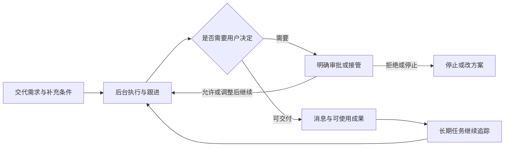

# Muse：为什么容易上手，为什么能登顶美区

调研日期：2026 年 10 月 21 日，北京时间。对象：**Muse from Meta**，App Store ID 6760173601。本文将公开事实、截图观察、他人实测与设计推断分别标明。

适用范围：官方后续公告列出美国、加拿大市场，商店年龄分级为 18+；本文不构成中国区可用性验证。[官方地区说明](https://about.fb.com/news/2026/09/introducing-muse-small-business/)、[App Store](https://apps.apple.com/us/app/muse-from-meta/id6760173601)

**核心判断：Muse 把“向 AI 提问”扩展为“把一件事交出去，然后在必要时回来做决定”。它的设计价值，在于减少表达需求、发现能力、跟踪进展和接续工作的负担。免费基础体验、Meta 的推广与分发可能共同促成增长，公开数据不能分解 UI 的独立贡献。**

这也限定了“好用”的含义：对有持续数字杂事、愿意连接账号的人，它提供了有吸引力的委托方式；任务是否更快、更准地完成，仍要按具体场景判断。

## 1. 先核对“霸榜第一”

| 时间 | 核对结果 | 口径与来源 |
|---|---|---|
| 9 月 8 日 | Meta 发布 Muse | 官方公告后来更新过，不能把当前全部能力当成首发已有。[Meta 发布说明](https://about.fb.com/news/2026/09/introducing-muse-personal-ai-agent/) |
| 9 月 18 日 | 已登顶美国免费 iPhone 总榜 | 这是总榜证据。[Axios 当日报道](https://www.axios.com/2026/09/18/meta-muse-personal-agent-make-money) |
| 9 月 30 日 | 报道称连续约 12 天居首；美国累计下载约 500 万 | 下载为 Sensor Tower 估算，合并 iOS 与 Android。[9to5Mac](https://9to5mac.com/2026/09/30/report-metas-muse-crosses-5-million-downloads-amid-massive-advertising-push/) |
| 10 月 20 日 | 报道称美国前 40 天下载超过 1000 万，曾短暂失去榜首后重回第一 | 不能写成全程连续第一。[TechCrunch](https://techcrunch.com/2026/10/20/metas-muse-hits-10m-u-s-downloads-in-40-days-a-milestone-reached-by-only-11-other-apps/) |
| 10 月 21 日查阅 | App Store 页面显示效率类第 1、约 31.2 万评分、4.9 分 | 分类排名、评分、下载量是不同指标；商店快照也会变化。[美国商店页](https://apps.apple.com/us/app/muse-from-meta/id6760173601) |

最新媒体引述 Sensor Tower 的估算包括美国下载约 1020 万、总下载约 1090 万、D7 留存约 30%、D14 约 23%。已有早期留存信号，但比较材料对地域、批次、竞品均值与单一竞品使用不同口径；有一份材料甚至对竞品 D14 写了两个不同均值。本文不据此判定 Muse 的长期留存胜过 ChatGPT。未取得原始用户级数据，也未独立复算第三方估计。[PPC Land 的数据与方法说明](https://ppc.land/metas-muse-gains-10-million-us-downloads-in-40-days-sensor-tower-finds/)

**能确认的是登顶及较长时间的榜首表现；“连续霸榜至今”“因为 UI 所以第一”“用户长期最爱”都不是同一个结论。**

## 2. 这次用了哪些方法

本次采用公开资料研究与界面观察，检索产品名称、榜单、官方设计、演示、帮助、用户评价及失败案例；将榜单增长、交互证据、用户反馈分为三个并行研究方向，再检查结论之间是否矛盾。优先采用官方功能说明、设计者演示与媒体亲自操作的记录。新闻转载、社区自述用于补充，不能充当独立实验。

| 方法 | 实际完成范围 | 能回答什么 |
|---|---|---|
| 官方设计拆解 | 读取《How We Designed Muse》的搜索索引全文 | 设计者为什么选择主对话、气泡、角色、Ideas 与审批 |
| 官方帮助核验 | 入门、个性化、连接器、审批、浏览器、数据管理 6 篇 | 功能入口、操作规则、权限与删除边界 |
| 视频研究 | 取得官方 2 分 32 秒导览英文字幕，以及设计主管长访谈的公开转录，核对时间点 | 页面结构、状态与等待的设计理由；不等于观看完整像素与动效 |
| 视觉观察 | 亲眼检查 5 张公开图片：两张 Android 实际聊天截图、活动/目标/结账三联图、Ideas、Artifacts | 层级、颜色分工、信息组织和可见控件 |
| 公开使用记录 | 媒体实测、商店可见评论、公开可索引的社区帖子 | 成功案例与失败方式；不能计算总体发生率 |
| 增长核验 | 历史榜单报道、Sensor Tower 的媒体引述、Meta 高管访谈 | 登顶时间、分发机制、数据口径与归因限制 |

**没有完成的部分：** 未登录 Muse，未进行 iPhone 真机任务测试、付费、账号授权、推送实测或可用性访谈；没有测得响应时间、点击数、成功率、VoiceOver、Dynamic Type、深色模式或弱网恢复。首次启动的完整页面顺序也未验证，不能把公开案例串成确定的 onboarding。

工具可用性也影响了覆盖：Agent Reach 体检显示本机缺少 Exa 与社交平台 CLI 后端，未获得小红书、X、Reddit 的登录态全量访问；使用内置网页检索补充公开资料。Jina 读取未成功返回，不能列为已完成渠道。浏览器打开 Muse 官网与 App Store 均被安全策略拒绝，未继续浏览器实测。截图来自其他公开报道，保留来源；并非本次账号操作截图。

## 3. Muse 的产品结构：五个页面对应五种需求

官方短视频核验了 Chat、Feed、Ideas、Goals、Library。它们分别容纳交办、定制信息、能力发现、长期目标与跟踪事项、成果。[官方导览](https://www.youtube.com/watch?v=wHn0hTjvFoo)

提醒与定时任务另有 Assistant → Upcoming 入口，不能把所有持续任务都归入 Goals。[Meta 数据管理帮助](https://www.meta.com/help/artificial-intelligence/2225571704857152/)

| 页面 | 对应用户的问题 | 设计判断 | 需要警惕的代价 |
|---|---|---|---|
| Chat | 我现在要交代什么？ | 用熟悉的消息入口承接复杂任务 | 多个任务与闲聊可能混杂，回找困难 |
| Feed | 我希望它定期替我整理什么？ | 用自然语言描述信息偏好 | 省时间的工具可能增加阅读负担 |
| Ideas | 我还能让它帮我做什么？ | 把抽象能力变成有上下文的提议 | 建议若夸大能力，会提前透支信任 |
| Goals | 它还在替我盯着哪些事？ | 给长期委托一个稳定位置 | 如何区分进行中、停滞、失败仍需实测 |
| Library | 它之前交付的东西在哪里？ | 让结果拥有独立对象，便于再次使用 | 保存不等于已经验证搜索、编辑、导出好用 |

**它没有把所有内容都压成聊天。** 对话负责表达与调整；状态、目标、成果、审批各自有更明确的容器。这种分工有助于把临时回答组织成持续工作，但五个入口自身也增加了学习成本。

下面按已核验的功能重建委托流程，用于解释设计；不是某次真实任务的操作录像：

可按以下时间点核对官方演示：00:09 Chat；00:53 状态与审批；01:09 Feed；01:31 Ideas；01:51 Goals；02:14 Library。此处是视频导航，不能用来证明真实任务都按宣传完成。

## 4. 为什么容易上手：七个交互选择

### 4.1 可以像发消息一样不断补充

入门帮助明确：打开进入 Chat，不必等上一条回复才能发送下一条；可以补充条件、要求调整。Side chats 用于整理话题，但主对话和侧对话之间仍保持认知，**不应理解为隔离记忆的私人空间**。[Meta 入门帮助](https://www.meta.com/help/artificial-intelligence/1331373868832401/)

**设计判断：** 人们交代生活任务时，通常先讲大意，再想起预算、时间、偏好。允许补充的交互符合这种表达方式。用户不必一开始就组织出完整规格，也不必将一次修改重新包装成新任务。

需要分清三件事：能连续发消息是输入体验；能管理多个委托是任务体验；是否真正并行、是否更快是执行表现。本次只确认前两者的产品设计，不据此宣称执行速度。

### 4.2 能力发现替用户完成一部分“想问题”的工作

官方设计文承认，早期用户面对过多能力会不知道从何开始，因此提供初期提示、Ideas 和结合个人情境的建议。设计者也解释，主动消息的边界需要清楚，气泡用于区分连续抵达的不同想法。[官方设计说明](https://introducing.muse.ai/)

**设计判断：** “你想问什么”要求用户先想象产品能力；“你提到周末出行，我可以替你整理准备事项”让用户判断一件具体提议是否值得做。后者减少了从日常烦恼到可执行指令的转换工作。

这是一种能力教育，不代表授权一定按需索取，也不代表建议一定做得到。能力示例必须与实际执行保持一致。

### 4.3 身份与口吻可以在相处中调整

官方帮助支持更改姓名、头像、语气、回复长度及偏好，不要求一次完成所有配置，也支持导入其他助手的聊天 ZIP。[Meta 个性化帮助](https://www.meta.com/help/artificial-intelligence/995796179982326/)

**设计判断：** 用户可以先说一句话，再要求“短一点”“随意一点”。这比填写冗长偏好表更容易保持当前任务的连续性。命名和外形则给“长期和同一个代理相处”一个可识别身份。

身份定制和任务效能要分开评估。用户喜欢头像，并不意味着它对日历、购物或资料处理更可靠。

### 4.4 允许离开，让价值跨越一次会话

Meta 的产品说明将后台持续处理、跟进、在有变化或需要批准时再通知作为主要工作方式。[Meta 发布说明](https://about.fb.com/news/2026/09/introducing-muse-personal-ai-agent/)

**设计判断：** 对比一次性获取答案，长期监控还接管了“记得再查”的负担。价格变化、等待邮件回复、定期整理这些任务特别适合这种方式。用户回来的理由由任务本身提供。

这也提高了产品必须承担的责任：用户离开后，很难知道任务是不是漏做。要验证体验，必须观察多日任务、漏通知、旧数据与停止后的行为，不能只演示创建成功。

### 4.5 状态可以展开，后台工作有地方查

活动界面与帮助说明提供当前工作、历史活动和 Upcoming；浏览器任务还提供观察、接管和停止入口。[审批与活动帮助](https://www.meta.com/help/artificial-intelligence/1385290430137537/)、[浏览器帮助](https://www.meta.com/help/artificial-intelligence/2124746764949121/)

**设计判断：** 状态可按需求分层：平时只看简短概况；担心时看具体活动；关键时刻介入。用户不必一直看执行过程，也能保留监督路径。

这也有设计者一手说明：Alex Cornell 在 10 月 12 日访谈中描述，从是否在工作、工作主题，到活动与更深执行细节逐步展开。它让不同经验的用户获得不同深度的信息，不能将其机械理解为固定三个页面。[访谈 07:42 起](https://www.youtube.com/watch?v=4TOLm1g-gCE&t=462s)

但是，“正在处理”只说明存在反馈，不证明进度真实。真正有用的状态应回答：做到哪里、为何等待、需要我做什么、能否停下。没有核实这些信息之前，不应把动画当成可信进度。

### 4.6 关键决定回到明确控件

官方说明提供允许或拒绝、不同范围的授权、任务详情与权限默认值。浏览器里的接管会暂停代理，停止则终止当前浏览器工作；已发生的某些动作无法撤回。[审批帮助](https://www.meta.com/help/artificial-intelligence/1385290430137537/)、[浏览器帮助](https://www.meta.com/help/artificial-intelligence/2124746764949121/)

**设计判断：** 交代目标时，自然语言很灵活；决定是否支付或发送时，用户需要确定范围。专门的审批卡片能让“讨论”和“执行承诺”在界面上有区别。

审批体验还取决于频率与授权范围。反复确认会导致机械点击，长期许可又可能超出用户当时想象；有按钮不等于没有风险。

### 4.7 将输出变成可继续使用的成果

公开成果图展示旅行计划、开学指南和装箱清单，而不是统一的文字气泡；官方导览也展示可交互的棋局分析。[官方导览](https://www.youtube.com/watch?v=wHn0hTjvFoo)、[公开图源与报道](https://rar.design/posts/meta-muse-personal-ai-agent-guide)

**设计判断：** 用户的目标可能是“拿着清单收拾东西”，不是“读完一篇关于收拾的回答”。输出形态靠近使用情境，能减少二次整理。聊天负责生成和修改，成果界面负责实际使用。

自动生成界面也有一致性、可访问性和质量风险。一次好看的样例不能证明每次产出都清楚，也不能证明数据正确。

生成也有边界。Cornell 说明头像可以映射到不同工作状态，但 Feed 当时仍使用设计好的原生单元，并非整套界面全部临时生成。稳定框架与可变内容需要分开评估。[访谈 12:10 起](https://www.youtube.com/watch?v=4TOLm1g-gCE&t=730s)、[14:09 起](https://www.youtube.com/watch?v=4TOLm1g-gCE&t=849s)

## 5. UI：亲眼看见了什么，为什么值得研究

以下五张图片保持公开图源原貌。官方样例是设计展示，Android 截图是记者使用记录；它们不代表所有设备、版本和用户的界面。

图 1：Meta 设计示例，由 [RAR 报道](https://rar.design/posts/meta-muse-personal-ai-agent-guide)转载。左为活动，中央为 Goals，右为结账审批。图中的商品、价格、任务和付款尾号均为公开展示内容，不是本次真实交易。

| 可见设计 | 具体观察 | 我的设计解读 |
|---|---|---|
| 角色集中呈现 | 左屏上方头像、名字、当前工作文案组合 | 身份与系统状态共用一个稳定锚点，减少另找状态栏的动作 |
| 主次分明的列表 | 任务标题深色，动作说明与时间较浅 | 先扫“在做什么”，需要时再读细节；弱文字对比仍要另测 |
| 活动行内停止控件 | 正在工作的行右侧有方形停止符号 | 控制靠近受影响对象；纯图标的含义与误触风险需测试 |
| Goals 分组 | Tracking 为绿，Goals 为蓝，另有文字标签 | 区分持续盯梢与长期方向；并非只靠颜色传达含义 |
| 购买前信息集中 | 商家、商品预览、查看订单、支付方式、预计总额在同一页面 | 让用户有材料判断具体购买，而非只同意模糊意图 |
| 拒绝与允许同排 | 两个按钮接近等宽，Allow 蓝色、Deny 浅灰 | 拒绝入口可见，但两者视觉强调并不相等，不能称完全中性 |

**最值得借鉴的是信息分工：可爱部分负责辨认与情绪，执行部分负责状态，交易部分负责事实和决定。** 如果只复制角色外观，就漏掉了界面大部分的工作。

图 2：Meta 的 Ideas 设计样例，图源为 [RAR 报道](https://rar.design/posts/meta-muse-personal-ai-agent-guide)。

从图上可见，每项以小型实物风格图标、较粗的提议标题、较浅的说明组织，描述具体人物、计划和约束。**设计判断：** 它把菜单式的“写作、搜索、购物”变成有个人情境的邀请，用户更容易判断是否相关。但说明文字也很长；对赶时间的人，扫描和理解仍有成本。

图 3：Meta 的 Artifacts 公开样例，图源为 [RAR 报道](https://rar.design/posts/meta-muse-personal-ai-agent-guide)。

旅行、学校、装箱三个成果拥有不同视觉样式，外部保留标题、类型与日期。**设计判断：** 稳定的外部容器支持寻找，内部根据任务变化支持使用。这比所有输出都采用相同长文本更贴近实际工作。不过标题截断、版本、搜索和归档是否易用，本次未测试。

图 4：[Android Authority 的一周实测](https://www.androidauthority.com/meta-muse-one-week-later-hands-on-3718233/)，Stephen Radochia / Android Authority，2026-10-06。这是作者的 Android 界面，不用于推断 iOS 全部细节。

实际聊天图显示白色基底、浅灰代理气泡、桃色用户气泡、蓝色链接、黑色主要文字；顶部是可定制橘猫，底部是输入框与五个导航图标。

**我的视觉判断：** 温暖的角色和用户气泡让界面有个性，主体控件仍保持熟悉、克制；大圆角将每则内容围成边界，链接直接暴露来源入口。复杂任务不必同时带来复杂的表单界面。

图里也可见三种负担：头像区域占据明显高度，背景内容在其后淡出；底部导航没有可见文字标签；一条监控结果能占据大块屏幕。漂亮并没有自动解决信息密度与能力发现。

图 5：同一篇 Android Authority 实测的另一张公开截图；文件名与文章段落关联不代表这是 Feed 页面，图中实际仍是 Chat。

这张图支持更具体的批评：不同类型的定期输出回到同一聊天流后，长消息会增加扫描、定位和回找负担。更好的产品验证应观察用户如何从“看见更新”走到“找到相关任务并修改它”，而非只问角色是否可爱。

**本次不提供所谓官方设计参数。** 未取得设计源文件，不能确认字体名称、字号、精确色值、间距、圆角、动画时长与曲线。网络上多个同名 Muse 和第三方复刻仓库的设计规范不能当作 Meta 的事实。

## 6. 文案和等待体验，如何共同降低陌生感

Muse 的公开案例常用人的日常工作来解释能力：找东西、整理、盯着变化、替人准备好下一步。截图中的任务状态也描述具体动作。**设计判断：** 这帮助用户理解代理正在为哪个目标工作，少一层理解模型或工具架构的负担。

命名、可定制外形和工作动画形成稳定角色。Android Authority 作者将角色改为橘猫，并描述了工作时敲电脑的动画；其一周使用记录提供了这种包装如何被实际感知的例子，但不能代表所有用户。[Android Authority](https://www.androidauthority.com/meta-muse-one-week-later-hands-on-3718233/)

需要明确区分：本次看到的是静态截图，并读取他人对动画的描述，**没有亲自测量动效节奏与等待时长**。角色动画能让等待有解释，但不能代替真实进度、阻塞原因与失败出口。

Cornell 对复杂任务的解释更具体：先用简短消息或反应认领，再继续执行，状态供用户检查是否卡住或走偏。**我的设计判断：** 及时确认“收到了”与最终“做完了”是两个不同反馈，分开提供可以减少用户重复发送或怀疑请求丢失；这不证明实际任务更快。[访谈 09:53 起](https://www.youtube.com/watch?v=4TOLm1g-gCE&t=593s)

一个适合判断此类产品的关系式是：

> 实际省事程度 ≈ 省下的操作与惦记 − 交代、授权、等待、检查和纠错的成本。

这是分析框架，不是测得的公式。Muse 的好设计减少前半程负担；当执行不可靠，后半程检查与纠错就会抵消收益。

## 7. 三组任务，检验“好用”是否落地

| 任务 | 公开使用记录 | 可以得出的结论 | 不能得出的结论 |
|---|---|---|---|
| 每天找合适的古董电子设备 | Android Authority 作者最初结果不满意；补充成色、上架时间和购买方式后，每天两次监控变得有用 | 自然语言可以修改持续任务，价值来自反复运行 | 所有监控都准确；每个人都能同样省时 |
| 联系朋友并整理旅行建议 | CNN 记者连接 Google 服务后，让代理发邮件；收到回复后整理为 Google Doc | 跨沟通与整理的链条能产生可使用成果 | 这是无需授权或监督的全自动过程 |
| 推荐与预订、购买 | 同一 CNN 测试出现倒闭餐厅、商家限制、结账需要手填，以及 Ideas 描述与实际响应不一致 | 最后一步、信息新鲜度、能力承诺仍可能失效 | UI 清楚就意味着实际目标一定完成 |

前一例来自 [Android Authority 一周实测](https://www.androidauthority.com/meta-muse-one-week-later-hands-on-3718233/)；后两例来自 [CNN 记者 Lisa Eadicicco 的实测，CNN Newsource 正式转载](https://krdo.com/money/cnn-business-consumer/2026/09/23/meta-says-its-muse-ai-agent-can-do-things-for-you-i-put-it-to-the-test/)。它们是少数作者的短期记录，不能合并计算成功率。

**最适合的任务特征：** 多步骤、重复发生、需要等外部变化，而且用户能给出明确边界与验收结果。例如价格监控、邮件跟进、定期汇总。

**优势较不稳定的任务特征：** 自己几秒就能做完，或对即时事实、精确日期、商家可访问性和一次成功要求很高。代理的启动、登录、等待与复核可能比直接操作更重。上述是基于案例的任务选择判断，尚未通过统一测试集验证。

## 8. 为什么能迅速登顶：把设计与分发分开看

### 8.1 价值很容易说清楚

“把杂事交出去”有明确场景；省时间、省钱、漏事提醒也容易展示前后变化。**我的增长推断：** 这些价值比抽象模型能力更容易被普通人理解，也更适合传播。但精选成功故事存在选择偏差，不代表平均收益。

### 8.2 Meta 把用户教育提前放进获客素材

Connor Hayes 接受 Peter Kafka 采访时说明，推广需要按用户兴趣展示 Muse 能替其完成的具体用途。[Business Insider 访谈](https://www.businessinsider.com/meta-threads-connor-hayes-ai-growth-interview-kafka-2026-9)

**我的增长推断：** 用户下载前已看到“这件烦恼可以交给它”；进入产品后，Ideas 又延续这种教育。获客和产品内的能力发现沿用同一种解释方式，能减少下载后不知道做什么的断层。访谈没有提供这种设计的增量转化实验。

### 8.3 分发与推广规模不能忽略

9to5Mac 引述 Sensor Tower：Meta 9 月 16 日加大 Muse 推广，当日下载环比增加约 73%；特定时期 Muse 占 Meta 自有宣传广告每日曝光的比例一度约一半。[9to5Mac 数据报道](https://9to5mac.com/2026/09/30/report-metas-muse-crosses-5-million-downloads-amid-massive-advertising-push/)

这支持推广参与增长的解释，但仍是时间关联。它不能告诉我们广告造成了多少新增，也不能把广告曝光占比换算成下载来源比例。

### 8.4 免费基础体验让试用更容易

官方说多数日常需要可以免费使用，另有订阅计划。[Meta 发布说明](https://about.fb.com/news/2026/09/introducing-muse-personal-ai-agent/)

**我的增长推断：** 先尝试真实任务，再判断价值，可以降低下载与试用的经济门槛。连接账号、隐私、地区、配额与监督仍有成本，不能写成完全免费无限用或人人无门槛。

### 8.5 推荐奖励提供额外传播动机

社区存在互换推荐码、用 token 奖励促成分享的公开记录。[Reddit 推荐码讨论](https://www.reddit.com/r/MetaAI/comments/1wivz46/megathread_muse_invite_codes_share_request_here/)

这能证明有激励的推荐传播存在，不能量化其贡献，也不能把全部分享当成自然口碑。早期邀请码、等待名单与地区体验不同，本文不认定所有用户必须靠邀请码进入。

### 8.6 交互与执行共同影响下载后的使用

**综合推断：** 榜单增长可以拆成“看见用途 → 愿意下载 → 能开始一件事 → 交付有感结果 → 有理由再来”。推广与分发主要扩大前两步的机会，交互与执行影响后几步。任何一环都可能卡住，现有资料不能赋予它们精确权重。

| 解释 | 证据支持程度 | 本报告的结论边界 |
|---|---|---|
| 确实到过美区免费总榜第一 | 历史报道可确认 | 不代表所有时间连续第一 |
| Meta 推广参与了增长 | 有推广事实和下载同步变化 | 广告增量贡献未知 |
| 设计减少某些使用负担 | 有官方规则、界面与案例支持 | 仍需可用性实验与真实任务验证 |
| 有早期使用与留存信号 | 第三方估算 | 长期优势与单品全面领先未证实 |
| 因为吉祥物或 UI 所以第一 | 没有隔离变量的证据 | 不成立为因果结论 |

还要保留时间边界：9 月 18 日已有总榜第一报道，9 月 23 日以后宣布或上线的能力，最多解释后续关注与使用，不能用来解释之前的榜单表现。拿 Muse 与多年以前其他产品的首发下载速度相比，也同时混入了市场认知、分发、地域和平台覆盖变化。

## 9. 最大体验矛盾：越想省心，越要理解授权与记忆

连接器帮助写明，可以从聊天或设置中建立连接；同一 Accounts Center 中的 Facebook、Instagram、Threads 可能自动连接。断开连接会停止后续数据交换，但之前进入聊天与记忆的信息可能保留。[Meta 连接器帮助](https://www.meta.com/help/artificial-intelligence/1687253048996149/)

数据帮助写明：模型改进开关首次使用默认开启；记忆文件可以查看、编辑；删除消息不保证抹去从中学到的信息；完全重置不可逆。[Meta 数据管理帮助](https://www.meta.com/help/artificial-intelligence/2225571704857152/)

**我的 UX 判断：** 这些行为对普通用户并不直观。用户可能把“删除对话”“断开邮箱”“让它忘掉”“重置全部”当成类似动作，实际影响不同。能够在聊天中提出请求很方便，最终结果仍需要确定界面解释与核验。

商店评论同时包含明显正负反馈：有用户喜欢日程、列表与持续提醒。美国主商店页中，Joseph E Rouse 在 10 月 10 日的一条评论里自述记忆错误、邮件分拣未完成与删除 Meta 账号出错；加拿大展示评论亦有连接困难的自述。这些是问题线索，不能据此认定发生率，也不能把评论者关于数据使用的猜测当成已证实事实。[美国主商店页](https://apps.apple.com/us/app/muse-from-meta/id6760173601)、[加拿大商店评论](https://apps.apple.com/ca/app/muse-from-meta/id6760173601?platform=ipad&see-all=reviews)

公开社区还有旧日历数据与定期任务漏做的自述，亦有用户说正常运行。它们提醒研究者检查数据新鲜度与恢复入口，不能证明产品普遍失效。[日历讨论](https://www.reddit.com/r/MetaAI/comments/1x400ub/calendar_access/)、[任务可靠性讨论](https://www.reddit.com/r/MuseAgent/comments/1x2dtux/muse_getting_dumber/)

**当“我相信你会替我记得”成为卖点，漏做就比一次回答不好更伤信任。** 这是此类持续代理必须验证的体验成本。

## 10. 对“显化”项目，值得借鉴哪些原则

以下为基于本次研究的设计建议，不是 Muse 已验证的效果，也不是对现有原型的修改。

| 优先级 | 借鉴原则 | 在“显化”中的具体落点 | 建议如何验证 |
|---|---|---|---|
| P0 | 用户容易开始 | 首屏允许直接写一句，不先完成长测评 | 用户能否说清自己现在可以做什么 |
| P0 | 对话有可见结果 | 一次对话留下用户确认的记录、一小步或回顾 | 结束后能否找到刚才留下的东西 |
| P0 | 持续事项有独立位置 | 将“现在仍想继续的事”与聊天记录分开 | 次日能否接着做、调整或放下 |
| P0 | 记忆可见可改 | 展示记住的内容、来源与时间，允许纠正 | 用户能否改掉一条错误记忆并看到生效 |
| P0 | 明确何时主动 | 用户选择提醒的事情与节奏，提供暂停 | 用户是否理解为什么收到这次提醒 |
| P1 | 能力发现结合情境 | 根据刚说过的内容给少量建议，允许忽略 | 建议是否相关，是否增加负担 |
| P1 | 给个性化留空间 | 可以改称呼、语气与回复长短 | 是否有帮助，是否影响阅读效率 |
| P1 | 成果接近使用情境 | 行动签、周回顾、愿景卡有各自适合的形式 | 用户是否愿意再次打开并使用 |

不宜直接照搬的部分包括五个底部入口、持续信息流、大量账号连接、丰满角色占据首屏，以及较复杂的许可层级。当前项目仍应根据最常见的任务决定界面，而不是复刻一个成熟代理的全部结构。

**最优先学习的是：一段对话结束后，用户清楚知道留下了什么、下一步是什么、哪些事需要自己决定，以及之后如何回来继续。**

## 11. 后续若做真机验证，怎样把结论补实

以下为测试建议，本次没有执行。

| 测试任务 | 关键观察 | 为什么有价值 |
|---|---|---|
| 首次交办一件低风险任务 | 首次有用结果耗时、澄清次数、是否理解能力边界 | 分辨亲切外观与实际可用性 |
| 执行中补充限制 | 能否修改原任务、有无重复执行 | 检验消息式补充是否可靠 |
| 离开后等外部变化 | 任务是否运行、数据更新时间、通知是否准确 | 验证持续工作的核心承诺 |
| 拒绝一次关键审批 | 用户能否理解拒绝后影响，是否能改方案 | 验证控制不是形式入口 |
| 接管后交回 | 如何暂停、恢复、终止，结果是否一致 | 观察人机协作的恢复成本 |
| 两天后寻找并修改成果 | 查找耗时、版本、编辑、导出 | 验证成果沉淀的实际价值 |
| 更改记忆、断开连接 | 用户是否理解保留与删除的范围 | 检查退出成本与控制感 |

建议与“自己直接完成同一任务”比较总耗时、注意力投入、纠错次数、最终成功率，而不是只比较模型回复速度。连续任务至少观察多天；不得把单次演示完成率写成长期可靠性。

## 12. 来源、局限与核验记录

**主要一手来源：**

- Meta（2026-09-08，后更新）。[Introducing Muse](https://about.fb.com/news/2026/09/introducing-muse-personal-ai-agent/)。产品定位、后台工作和免费基础体验。
- Sarantakos, M., & Awad, C.（2026-09）。[How We Designed Muse](https://introducing.muse.ai/)。通过搜索索引读取，未直接访问域名；支持设计意图，不是独立效果验证。
- Meta（2026-09-08）。[Take the full tour of Muse](https://www.youtube.com/watch?v=wHn0hTjvFoo)。英文字幕已取得；只引用流程与页面事实。
- Meta Help Center。[入门](https://www.meta.com/help/artificial-intelligence/1331373868832401/)、[个性化](https://www.meta.com/help/artificial-intelligence/995796179982326/)、[连接器](https://www.meta.com/help/artificial-intelligence/1687253048996149/)、[审批](https://www.meta.com/help/artificial-intelligence/1385290430137537/)、[浏览器](https://www.meta.com/help/artificial-intelligence/2124746764949121/)、[数据管理](https://www.meta.com/help/artificial-intelligence/2225571704857152/)。2026-10-21 查阅；帮助页更新与全量发布可能不同步。
- Kafka, P.（2026-09-24）。[Connor Hayes 访谈](https://www.businessinsider.com/meta-threads-connor-hayes-ai-growth-interview-kafka-2026-9)。研究者取得可读内容，后续父会话重开未成功；仅采用已核验的具体用例推广陈述。
- Apple。[美国 Muse 商店页](https://apps.apple.com/us/app/muse-from-meta/id6760173601)。排名与评分为查阅快照，评论为展示样本。

**实测、图源与增长补充：**

- Radochia, S.（2026-10-06）。[Android Authority 一周实测](https://www.androidauthority.com/meta-muse-one-week-later-hands-on-3718233/)。使用记录与两张实际聊天截图。
- Eadicicco, L.（2026-09-23）。[CNN 实测 / CNN Newsource 正式转载](https://krdo.com/money/cnn-business-consumer/2026/09/23/meta-says-its-muse-ai-agent-can-do-things-for-you-i-put-it-to-the-test/)。跨工具成果、失败与商家限制。
- Riven（2026-09-24）。[RAR 设计报道](https://rar.design/posts/meta-muse-personal-ai-agent-guide)。仅将转载图片用于视觉核对；未采用其所有评价和商业推断。
- Mendes, M.（2026-09-30）。[9to5Mac 下载与推广报道](https://9to5mac.com/2026/09/30/report-metas-muse-crosses-5-million-downloads-amid-massive-advertising-push/)。转述 Sensor Tower。
- Rijo, L.（2026-10-21）。[PPC Land 数据口径说明](https://ppc.land/metas-muse-gains-10-million-us-downloads-in-40-days-sensor-tower-finds/)。通过可读材料与搜索索引交叉核对，未取得其所述原始三页研究 note。
- Perez, S.（2026-10-20）。[TechCrunch 榜首变化报道](https://techcrunch.com/2026/10/20/metas-muse-hits-10m-u-s-downloads-in-40-days-a-milestone-reached-by-only-11-other-apps/)。仅采用少量榜单事实，遵守来源摘要限制。
- Basu, Z.（2026-09-18）。[Axios 总榜报道](https://www.axios.com/2026/09/18/meta-muse-personal-agent-make-money)。仅用于确认当日美国免费 iPhone 总榜第一。
- Cornell, A., & Vo, C.（2026-10-12）。[设计主管访谈](https://www.lennysnewsletter.com/p/how-meta-designed-muse-an-ai-agent)。YouTube 字幕遇 429；随后从原页面已提供的公开转录链接取得正文。转录存在局部缺段，仅采用完整段落；未声称亲自观看全部演示。

社区与商店材料均非随机样本：评论有展示筛选与重复正文，研究时按作者、日期、正文去重；社区有用户自选、推广与推荐奖励干扰。没有把点赞当作满意率，也没有把账号权限争议当成已证实安全漏洞。

**反方核查的三次修正：**

1. 范围阶段：修正预设——先确认产品身份与总榜，不能默认“连续第一”或“UI 导致第一”。
2. 综合阶段：区分功能支持、界面观察与真实效能；将授权、记忆、第三方限制和版本时间纳入解释。
3. 成稿阶段：核对统计口径、来源与图片，检查有没有把官方演示写成亲自实测，保留无法验证的项目。

本报告由 AI 工具完成检索、证据整理、界面分析与写作，并经过并行研究者的交叉检查；没有招募受试者，也不声称经过人类可用性实验。保留的图片仅供本次产品研究与评论，版权归原作者或权利人；如另行公开传播，应核对使用许可。
